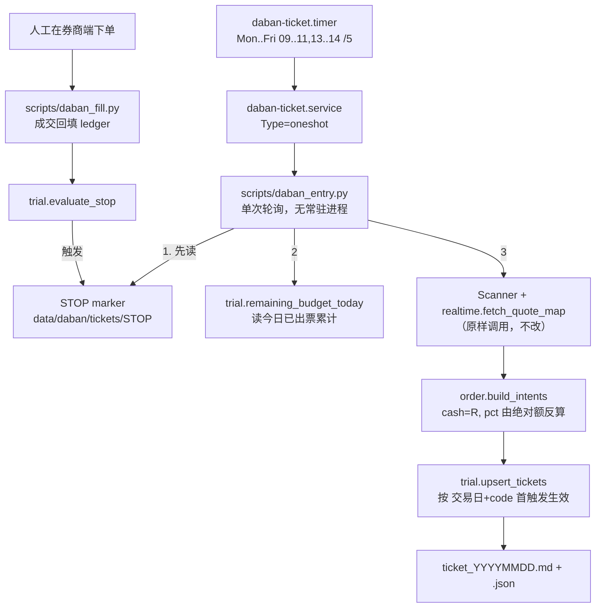

# daban 试验仓每日委托单产出 · 设计文档

日期：2026-10-25 ｜ 状态：待用户复核 ｜ 方案：A（新增薄编排层，不改 `daban_scan.py` / `order.py`）

## 1. 这次改的是什么，不改的是什么

2026-10-24 的决定是「daban 退出实盘入口，保留研究产出」，落地为 `scripts/plan_e_journal.py:667` 的
`DABAN_LIVE_BLOCK`：`--from-predict-list --mode real` 直接 `sys.exit`。

本设计**局部反转**那个决定，范围严格限定为：

| 反转 | 不反转 |
|---|---|
| 盘中自动跑扫描，产出**给人去券商端手工输入的委托单文本**（每天一份，含额度、止损止盈、理由） | `--from-predict-list --mode real` 仍然拒绝，`DABAN_LIVE_BLOCK` 一字不动 |
| 委托单是**新的文件通道** `data/daban/tickets/` | 不写 `journal.csv` / `positions.json`，不进 plan_e 实盘账本 |
| 带自动停止线，触发后自己不再出票 | 不接券商 API，不自动下单，不做手机推送 |

所以「实盘入口」这个词在本仓库仍是**人工执行**的意思：程序负责算与记，人负责下单。

## 2. 事实基线（每条都是本次实测，不是回忆）

- 委托单构造逻辑已在 HEAD：`tdxfeed/daban/order.py:150` `build_intents(candidates, cash, max_single_pct, max_total_pct, stop_loss_pct, take_profit_pct, lot, min_amount)`，`DryRunBroker.place` 落 `orders_*.csv/json` 并打印 `condition_order_text`（`scripts/daban_scan.py:218`）。**缺的只有调度、额度跨轮次累计、幂等和停止线。**
- `scripts/daban_scan.py` 是 319 行的纯手工入口：Makefile 里 `^daban` 目标数 = 0，`systemd/` 里没有它的单元，没有任何定时器会跑它。
- `tdxfeed/daban/paper.py`（888 行）与 `tdxfeed/daban/risk_gateway.py` **不在 HEAD**，本设计不依赖它们。
- 时段判定已有：`tdxfeed/daban/session.py:47` `current_session()` 返回 `pre_auction/auction/pre_open/continuous/lunch_break/closed`。`--phase` 是**市场环境标签**（退潮期/冰点转折/…，默认 震荡市），不是时刻。
- 负期望证据（诚实成交口径，两份独立研究）：`docs/DABAN_TOPK_PNL_20261022.md` K=5 成交 1509 笔、均净收益 −0.78%/笔、累计 −94.5%，未计成本毛收益 −0.58%（负号来自 T+1 开盘入场时点，不是手续费）；`docs/DABAN_PAPER_TRADE_RULES_20261022.md` Book B −0.903%/笔、停止线定在 +0.20%。**这五份 `docs/DABAN_*_20261022.md` 目前全部未入库**（`git ls-tree HEAD -- <path>` 为空），所以横幅要引用它们，必须随本设计一起提交。
- 成交逆向选择已被量化（`docs/DABAN_EXEC_RESEARCH_20261022.md`）：**未成交**的那批封板率 95.4%，**成交到**的那批只有 39.7%。含义是「委托单发出 ≠ 买到」，而且买到的恰好是更容易输的那批。停止线的统计口径必须按这个事实设计，见 §7。
- 现有守卫不能被本设计弄红：`tests/test_plan_e_journal_daban_entry.py`、`tests/test_predict_report_daban_caveat.py`、`tests/test_plan_e_live_retirement.py`、`tests/test_systemd_units.py`（`Documentation=` 每个空白分隔的 token 必须是 `http:// https:// file:// man: html:` 之一，且 `file://` 指向的库内路径必须存在）。

## 3. 参数（用户已定）与算术自洽检查

本金 **20 万**，试验仓 **总仓 10% / 单票 5%**：

| 量 | 值 | 来源 |
|---|---|---|
| `CASH` | 200000 | 用户选定 |
| `TOTAL_CAP` | 20000 元（20万×10%） | 试验仓总仓上限 |
| `SINGLE_CAP` | 10000 元（20万×5%） | 试验仓单票上限 |
| `MIN_ORDER_AMOUNT` | 5000 元 | 必须低于 `SINGLE_CAP`，否则一张都出不来（`build_intents` 的 `if min_amount and amount < min_amount: continue`） |
| `LOT` | 100 股 | 沿用 `order.py:157` 默认 |
| `STOP_LOSS` / `TAKE_PROFIT` | −5% / +10% | 沿用 `daban_scan.py` 默认 |

由此得出两条**设计后果**，不是 bug：

1. **单日最多 2 只**。`total_cap=2万 / single_cap=1万` ⇒ 打满即 `used >= total_cap` 停。⇒ n=30 的统计判停最快 15 个交易日，约 3 周。这是 daban 与方案 E 的关键差别（方案 E 的样本产量 17 笔/年 ⇒ 需 70~120 年，所以「用实盘验证」对它不可行；这条线在 3~6 周内真能攒到 n=30）。
2. **约 100 元以上的票自动出不了**。`shares = int(budget // price // lot) * lot`，`budget=10000`、`price=101` ⇒ 0 手 ⇒ 该票被静默跳过。横幅里写一句「本试验仓只覆盖单手金额 ≤ 额度的高价股以外的票」。
3. **北交所（bj）不进试验仓**。`build_intents` 只有一个全局 `lot=100`，没有按板块区分申报单位；本设计不改 `order.py`（非目标），所以只对「100 股整手」这个前提成立的板块出票。这是「不确定就不下」，不是对北交所申报规则的断言。
4. `allow_st=False`（`Scanner` 默认）沿用：主板 ST/*ST 在 2026-07-06 并轨前是 ±5%，而本仓库还没有历史 ST 名称表可判（`get_limit` 的 name/on_date 已修，但训练标签那条线未解），试验仓不去踩这个不确定。

## 4. 架构：三个新单元 + 两只 timer



### 4.1 `tdxfeed/daban/trial.py`（新，纯逻辑，不碰网络不碰行情）

唯一职责：**额度、幂等、停止线**。可脱离行情单测。按完整路径 import（`from tdxfeed.daban.trial import ...`），**不改 `tdxfeed/daban/__init__.py`**（`tdxfeed/` 不 import `tdxfeed/daban/` 的既有边界靠它维持）。

```python
CASH, TOTAL_CAP, SINGLE_CAP, MIN_ORDER_AMOUNT = 200000.0, 20000.0, 10000.0, 5000.0
STOP_LOSS_PCT, TAKE_PROFIT_PCT = 0.05, 0.10

def tickets_path(root, trade_date) -> Path          # data/daban/tickets/ticket_YYYYMMDD.{md,json}
def load_day(root, trade_date) -> DayLedger          # 缺文件 → 空账本（首笔）
def committed_amount(ledger) -> float                # 当日已出票金额合计
def remaining_budget(ledger, total_cap=TOTAL_CAP) -> float
def build_kwargs(R: float) -> dict                   # 见下方换算
def upsert_tickets(root, trade_date, intents, banner) -> tuple[list, list]
                                                     # (新出票, 因重复被丢弃)，首次触发优先
def evaluate_stop(fills) -> StopVerdict              # 见 §7；只算已平仓 pair
```

`build_kwargs` 是 §3 里跨轮次额度的正解。`build_intents` 的入参是**比例**，而试验仓的约束是**绝对额**，直接传 `cash=200000` 会让 48 轮各自按满仓出票、日累计远超 2 万。所以：

```python
def build_kwargs(R: float) -> dict:
    return dict(cash=R, max_single_pct=SINGLE_CAP / R, max_total_pct=TOTAL_CAP / R,
                stop_loss_pct=0.05, take_profit_pct=0.10, lot=100, min_amount=MIN_ORDER_AMOUNT)
```

`single_cap = R × (SINGLE_CAP/R) = SINGLE_CAP` 精确成立；当 `R < TOTAL_CAP` 时两个上限同时被 `R` 夹住，只会更保守。`R <= 0` 直接不出票（额度已用满）。

### 4.2 `scripts/daban_entry.py`（新，单次轮询入口）

一次执行只做一轮，退出码 0 = 本轮无事可做或正常出票，非 0 = 真故障（让 `OnFailure=` 能叫）。顺序固定：

1. **STOP marker 检查**（第一件事，早于任何网络）：存在就打印停止原因并 `exit 0`。
2. **时段门**：`current_session()` 不是 `continuous` 就 `exit 0`（timer 每 5 分钟命中 09..11/13..14 共 60 次，其中约 48 次落在连续竞价；其余由这里挡掉）。
3. **交易日门**：以**行情自带的日期**为准 —— `Scanner._trade_date(quotes)`（`tdxfeed/daban/scanner.py:735`，取 `Quote.date`）不等于本地 `date.today()` 就说明交易所没在交易今天（节假日、数据滞后），整轮跳过并退出 0，委托文件名用的也是这个行情日期而非时钟。
   `tdxfeed/freshness.py:31` 的 `CN_HOLIDAYS` 只列到 **2026-10-08**，没有 2026-11/12 和 2027 元旦，所以它不能当唯一依据（可作早退的补充）；`scripts/precheck_freshness.sh` 那条 EOD parquet 新鲜度守卫在这里**不适用**，盘中轮询不读当日收盘数据。
4. 构造 `Scanner(phase=args.phase, min_pct=4.0, allow_st=False, use_sector=True, session_mode="auto", ...)`（取值与 `scripts/daban_scan.py:247` 那条人工路径一致；`--phase` 是**市场环境标签**，默认 `震荡市`，不是时刻。`session_mode="auto"` 让 `Scanner.scan()` 自己再读一次 `current_session()`（`scanner.py:390`），§4.2 第 2 步那道门只是省一次网络）。
5. `symbols = scanner.symbols()`，然后**先按板块过滤再拉行情**：丢掉 `bj` 前缀（§3 第 3 条），形状照抄 `daban_scan.py:261-263` 那个候选池过滤（`symbols = [s for s in symbols if s[2:] in keep]`）。随后 `quotes = fetch_quote_map(symbols)`、`result = scanner.scan(quotes)` —— 与人工入口同一条调用链，不自己发明。
6. `R = trial.remaining_budget(load_day(...))` → `build_intents(candidates, **trial.build_kwargs(R))`。
7. `trial.upsert_tickets(...)` —— 同 code 当日已有则丢弃，不重复出票。
8. 落 `ticket_YYYYMMDD.md`（给人看，可直接抄进券商 App）+ 同名 `.json`（给 `daban_fill.py` 读）；两个文件都是**就地覆写当日的完整列表**，靠 upsert 保证幂等，不靠追加。
9. 行情源失败/空候选：记一行日志，`exit 0`（这是常态，不是故障——触板本来就不是每分钟都有）。

不做的事：不写 `.blk`（那是 `daban_scan.py` 的手工用途）、不写任何 journal、不发通知。

### 4.3 `scripts/daban_fill.py`（新，人工回填）

```
venv/bin/python scripts/daban_fill.py --code 600xxx --fill --price 12.34 --shares 800 --fee 5.00
venv/bin/python scripts/daban_fill.py --code 600xxx --no-fill --reason 封死未成交
venv/bin/python scripts/daban_fill.py --code 600xxx --sell --price 13.10 --fee 6.20 --date 2026-11-03
venv/bin/python scripts/daban_fill.py --report
```

- 产 `fills_YYYYMMDD.csv`：`code, ticket_price, ticket_shares, filled(0/1), fill_price, fee_buy, sell_date, sell_price, fee_sell, net_pct, closed`。
- **净额只用券商回单里的真实费用**：`net_pct = ((sell_price×shares − fee_sell) − (fill_price×shares + fee_buy)) / (fill_price×shares)`。缺费用字段就拒绝参与均值统计并在 `--report` 里点名有几笔被排除——不臆造万 2.5 之类的费率。
- `--no-fill` 必填：未成交也是样本。停止线的**成交率**判据靠它，否则统计只剩逆向选择的半边（§2 那条 95.4% vs 39.7%）。

### 4.4 `systemd/daban-ticket.{service,timer}`（新）

参照 `systemd/plan-e-double-up.service` 的写法（`WorkingDirectory` + 显式 `PATH` + `OnFailure=onfailure-alert@…` + `StandardOutput=append:logs/…` + `Nice=10`）：

```ini
# daban-ticket.timer
[Timer]
# 分钟级区间在 systemd.time 里不可解析（`09:25..11:25/5:00` → 无效的参数），
# 只能粗放到小时再由脚本用 current_session() 精门。
OnCalendar=Mon..Fri *-*-* 09..11,13..14:00/5
AccuracySec=60s
Unit=daban-ticket.service
```

- **不写 `Persistent=true`**：错过的轮次补跑会拿旧行情出今天的票，这是有害的补跑，与 plan-e-double-up 的幂等重算相反。
- `TimeoutStartSec=180`（一轮 Scanner + 80 只/批 × 8 线程的行情抓取；给足冷启动，但不留到下一轮重叠）。
- `Documentation=file://$ROOT/docs/superpowers/specs/2026-10-25-daban-daily-ticket-design.md` —— 单个 token、必须是 URL、目标必须真实存在（`tests/test_systemd_units.py` 两关都管）。
- Makefile 的 `timer-enable`（:395）和 `timer-disable`（:396）是**硬编码名字列表**，不加 `daban-ticket` 就一键收口收不到它；`timer-status` 的 grep 模式（`tdxfeed|predict-daily|plan-e|canary`）同理。

## 5. 横幅（每张委托单顶部，写死在 `trial.py` 的常量里）

```
⚠️ 这张榜按诚实成交口径没有正期望，本文件是排序研究到人工委托的过渡试验，不是买入指令。
   · docs/DABAN_TOPK_PNL_20261022.md：K=5 成交 1509 笔，均净收益 −0.78%/笔，累计 −94.5%；
     未计成本 −0.58%，负号来自 T+1 开盘入场时点，不是手续费。
   · docs/DABAN_PAPER_TRADE_RULES_20261022.md：Book B −0.903%/笔。
   · docs/DABAN_EXEC_RESEARCH_20261022.md：成交到的那批封板率只有 39.7%（未成交 95.4%）
     —— 你能买到的，恰恰是更容易输的那批。
   试验仓额度：总 2 万 / 单票 1 万（20 万本金的 10% / 5%）。
   自动停止线：五条，任一命中即停止出票，判据见本 spec §7，状态见 data/daban/tickets/STOP。
   人工执行：本程序不下单，文本抄进券商 App 由你按下确认。
```

引用路径的约束：横幅只能引用**随本设计一起入库**的 `docs/*.md`。`data/daban/execution_backtest_20261022.json` 这类被 gitignore 的产物不能出现在横幅里——`data/` 在 `.gitignore:42`，干净 checkout 上它不存在。（这正是现有守卫 `test_plan_e_journal_daban_entry.py:92` 在 HEAD 上必然红的成因：它检查的是工作树存在性，而 `docs/DABAN_TOPK_PNL_20261022.md` 从未被提交。本次把这三份文档提交，顺带把那条守卫修回可判定的状态。）

## 6. 失败模式

| 失败 | 行为 |
|---|---|
| STOP marker 存在 | 轮询第 1 步就退出，不联网 |
| 非连续竞价 / 非交易日 | 退出 0，日志一行 |
| 新浪行情源挂了或空返回 | 本轮 0 票，退出 0；判定「是不是源失效」不靠轮次计数，而靠当日是否有 `ticket_YYYYMMDD.json` —— `daban_fill.py --report` 遇到当日文件不存在就报「当日零出票，检查行情源 / 候选池 / 是否休市」，人工再去 `logs/daban_ticket.log` 看那一轮的门禁日志 |
| 当日额度已用满（`R<=0`） | 0 票，日志写明已用额 |
| 高价股凑不出一手 | 该票被 `build_intents` 跳过，横幅已声明这个约束 |
| 腾讯源挂了（`scanner.py:394` 静默 `tquotes={}`） | 官方涨停价缺失，退回新浪 L1 算出的 `limit_price`。这会直接影响股数（`shares` 按 `limit_price` 反算），所以委托单里必须打出**涨停价来源**字段，人工抄单前能看出是不是回退值 |
| tickets 目录不存在 / 半写状态 | 写临时文件 + `os.replace` 原子覆写（`data/` 被 gitignore，救不回来 ⇒ 覆写当日文件前先留 `.bak-<ts>`，与蒸馏语料同一条纪律） |
| 两轮 timer 重叠 | 同一 oneshot 单元不会并发第二个实例；`TimeoutStartSec=180` 兜住挂死 |
| 回填时找不到对应委托 | `daban_fill.py` 非 0 退出并列出当日委托单的 code 集合，不许凭空造一笔 |

## 7. 停止线（`trial.evaluate_stop`，单一实现，`daban_fill.py` 与 `daban_entry.py` 各调一次）

统计只用**已平仓** pair（`closed=1`）的 `net_pct`，未成交笔只进成交率。五条，任一命中即写 marker：

1. **样本量到即停**：`n ≥ 30` ⇒ 停，出报告。（最快 15 个交易日；这是「试验仓」的期限本身）
2. **前 10 笔不判均值**：`n < 10` 时继续（早期噪声不构成停或续的依据，也不许反过来说「暂时是正的」）。
3. **负期望确认**：`n ≥ 10` 且已平仓净均值 `< −0.20%/笔` ⇒ 停。阈值沿用 `DABAN_PAPER_TRADE_RULES_20261022.md` 里那条 +0.20% 停止线的量级，方向改负。
4. **真金止损**：累计已实现净亏 ≥ `TOTAL_CAP` 的 20%（= 4000 元）⇒ 停。这条不等统计量，亏钱先看住。
5. **成交率反证**：已回填 ≥ 10 笔中 `filled=0` 占比 ≥ 70% ⇒ 停，理由写「买不到，试验仓的样本口径无法覆盖策略真实意图」。

marker 内容：命中哪条、判据数字、样本量、可点开的 `fills_*.csv` 路径。
marker 是**唯一权威**：删掉它才会恢复出票，`systemctl --user disable --now daban-ticket.timer` 只是运维收口（两者都做，别只做一半）。

## 8. 测试（TDD，每条先 RED 再 GREEN）

| 守卫文件 | 断言 |
|---|---|
| `tests/test_daban_trial_budget.py` | 绝对额→比例换算精确还原 `SINGLE_CAP`/`TOTAL_CAP`；`R=0` 时 0 票；两轮累计金额 ≤ 2 万（**这条是本设计最可能出错的地方，必须先写**） |
| `tests/test_daban_trial_idempotence.py` | 同交易日同 code 二次 upsert 被丢弃、首次触发保留；换交易日重新计 |
| `tests/test_daban_entry_session_gate.py` | 注入 `auction/lunch_break/closed` 时刻 → 不调用行情层（用 `fetch_quote_map` 的调用计数器证明它一次都没跑）；`continuous` → 跑 |
| `tests/test_daban_ticket_banner.py` | 横幅含 −0.78 与 39.7；正则抓出所有 `docs/*.md`，逐个断言 `exists()` **且** `git ls-files --error-unmatch` 不报错（抓「只在工作树里存在」这一类） |
| `tests/test_daban_fill_net.py` | 净额 = 毛额 − 真实回单费用；缺费用 → 该笔被排除且 `--report` 报出被排除笔数；`filled=0` 参与成交率、不参与均值 |
| `tests/test_daban_stop_lines.py` | 五条各一正一反：`n=29` 不停 / `n=30` 停；`n=9` 均值为负不停 / `n=10` 停；回撤 3900 不停 / 4100 停；成交率 69% 不停 / 70% 停 |
| `tests/test_daban_channel_isolated.py` | 跑一轮 `daban_entry` 的桩执行后，`journal.csv` 与 `positions.json` 仍未被创建（把「不进 plan_e 实盘账本」钉住） |
| `tests/test_daban_ticket_timer_shape.py` | `OnCalendar` 字符串形态、**无** `Persistent=true`、`Documentation=` 是 URL；`Makefile` 的 `timer-enable`/`timer-disable`/`timer-status` 三个列表都含 `daban-ticket` |

行情层与 `order.py` 的既有测试不复写。全量验证口径：`venv/bin/pytest tests/ -q`（主集）+ `make test`（v5，本设计不该碰它）+ `make lint`（v5）。因为守卫里 shell out 了 git，入库后的复验用 `git worktree add --detach` 的干净 checkout，不用 `git archive | tar -x`（没有 `.git` 时 `git ls-files` rc=128，会把守卫测成假红）。

## 9. 非目标

不接券商 API / 不自动下单 / 不启用 `risk_gateway.py`（不在 HEAD）/ 不动 `daban_scan.py`、`order.py`、`scanner.py`、`plan_e_journal.py` 一行 / 不把委托单接回 predict 榜单或 journal 的 real 通道 / 不做手机推送（`pushplus-bridge` 不参与）/ 不修复历史 ST 名称表这条线 / 不改回测口径与四条显著性约定。

## 10. 落地与回滚

落地（每步都可单独验证）：

1. 提交：`trial.py` + 两个脚本 + 两只单元 + 8 个守卫 + **三份被横幅引用的 `docs/DABAN_*_20261022.md`** + Makefile 三处名单，全部带显式 pathspec（共享工作树纪律）。
2. `make timer-install` && `systemctl --user daemon-reload`（改 `systemd/` 必跑，否则加载的还是旧文件）。
3. 盘前彩排：`venv/bin/python scripts/daban_entry.py` 在 09:35 手跑一次，人工看 `ticket_*.md` 的额度、横幅、票数是否合 §3。
4. `systemctl --user enable --now daban-ticket.timer` —— **由用户执行**，或用户明确授权后代执行。
5. 每天收盘后回填；每周五 `--report` 看停线余量。

回滚（三层，从轻到重，都是可逆的）：

1. 停产出：`systemctl --user disable --now daban-ticket.timer`（不删文件，随时再来）。
2. 立刻停但保留 timer：写 `data/daban/tickets/STOP`（marker 优先，轮询第 1 步就退出）。
3. 完全下线：`git revert` 本次 commit + `make timer-install` + `daemon-reload`；`data/daban/tickets/` 整目录留在本地作研究档案（不删，同「研究产出保留」的先例）。

## 11. 已知风险（写清楚，不粉饰）

- 这条线的**先验是负的**。两份独立研究 + 一份执行研究都说同一件事：按诚实成交口径 daban 排序没有正期望。本试验仓的意义是「用 ≤2 万、3~6 周、带自动停止线的方式，在**当前**市场上重新量一次」，不是「这次一定能赚」。若 −0.20%/笔 的判定成立，它会在 n=10 就关掉开关。
- 委托单不等于成交，样本天然是「成交到的那批」（封板率 39.7% vs 未成交 95.4%）。`--no-fill` 强制回填是唯一把这一半补回来的办法；人不回填，统计就不可信——`--report` 会显式报未回填笔数。
- 行情是新浪 L1（`1ae2a78` 才改正 34 段口径：段 8/9 = 成交量/成交额、档位顺序「量,价」、seal = 买一量）。修正前采集的封单/撤单数字与本试验无关，但同源数据的可靠性只有 L1 级。
- 统计功效有限：n=30 在 σ≈20%/笔 的量级下，判不出 ±0.2% 的差别。所以停止线写成「均值 < −0.20% 即停」而不是「证明它显著为负才停」——它是**止损**，不是**检验**。
- 共享工作树风险：`timer-enable` 名单、`data/daban/` 目录、横幅引用的文档都可能被并行会话改动；每步提交前 `git status` 复核，`git add` 永远带显式路径。
